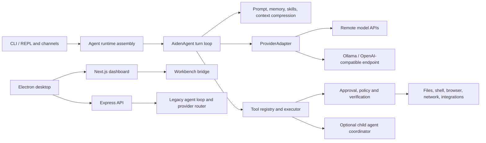

# Milo architecture: current implementation

This is a source-oriented snapshot of the inherited Aiden codebase, before a custom inference or neural engine is implemented. Existing identifiers and paths retain their names where they describe actual code. Historical comments and older architecture documents do not always describe current behavior; the code paths below are the authority. This is an inspection, not a runtime audit or a claim that every protection is enabled in every entry point.

## System map

The v4 agent orchestrates model calls and tools; it is not a neural network or an inference runtime. Providers execute model inference externally, including local Ollama. There is also older runtime code: the Express API imports `core/agentLoop` and `providers/router`; its OpenAI-compatible endpoint drives the API's agent SSE path. Do not assume changing the v4 adapter automatically changes all dashboard/API behavior. See `api/server.ts`, especially its imports and `/v1/chat/completions` handler, and `core/agentLoop.ts`.

## Entry points and product surfaces

- `cli/aiden.ts` and `cli/v4/aidenCLI.ts` implement the CLI and runtime assembly. The CLI creates the resolver, registry, executor, memory, prompt, compression and safety components, then constructs `AidenAgent`. `cli/v4/daemonAgentBuilder.ts` builds another agent for daemon work; channel and automation integrations have their own entry paths.
- `api/entry.ts` starts the Express server in `api/server.ts`. It includes a `/v1/chat/completions` compatibility endpoint, dashboard routes and streaming endpoints. Its legacy loop uses planner/executor/responder functions; it is not interchangeable with the v4 loop without migration work.
- `dashboard-next/` is a Next.js web dashboard. `electron/main.js` creates a desktop application and launches the dashboard and API processes; packaging is configured in the root `package.json`. The dashboard can also be served as a web interface. `landing/` currently contains deployment metadata, not a substantive checked-in site. Thus the repository contains both a desktop app and a web UI; this inspection does not establish a currently deployed public website. The desktop shell expects a Next.js standalone server, while `dashboard-next/next.config.js` currently configures a static export for the Workbench bridge. Desktop packaging and runtime compatibility were not verified and this mismatch needs investigation.
- Scheduled and durable work is implemented under `core/v4/daemon/`, `core/v4/cron/`, and `core/v4/automation/`, with state, execution and recovery concerns beyond a single interactive turn.

## V4 conversation lifecycle

`core/v4/aidenAgent.ts` owns `AidenAgent.runConversation`. The CLI injects a provider, schemas and `toolExecutor`, plus optional policy and context components. In broad order:

1. Refresh a dirty prompt snapshot, build or reuse the system prompt, narrow tool schemas by intent/profile, and establish per-turn trackers.
2. Prepend the system prompt to conversation history; optionally apply prompt-cache markers and compress context based on model limits, including tool schema cost. Learning retrieval can insert bounded, explicitly non-authoritative historical context before the current user message.
3. Call the provider with messages and selected tool schemas. Optional streaming emits deltas and assembled tool calls. Track usage, budgets, cancellation and provider errors.
4. Append the assistant response. Execute requested tools and append correlated tool results for the next model call. Mutating and exclusive interactions retain ordered dispatch; adjacent eligible read-only calls can run concurrently. The result boundary can store large outputs as artifacts and transmit bounded representations.
5. Repeat until a final answer, interruption, error or budget limit. The default iteration cap is 90, configurable by runtime; token and estimated cost limits may also stop work. Recovery, retry, skill enforcement, URL provenance and tool-call/result invariants add additional control paths.
6. Reconcile approval facts and run optional post-loop honesty checks against recorded outcomes; return content, messages, trace, usage and diagnostics. Checks and retries improve evidence handling but do not mathematically prevent fabrication.

The core loop is a single model/tool loop rather than the legacy planner/responder split. However, the repository does support optional delegation: `tools/v4/subagent/spawnSubAgentTool.ts`, `core/v4/subagent/coordinator.ts`, `childBuilder.ts` and `fanout.ts` build and coordinate isolated child agents. Availability depends on runtime wiring and configuration. This and concurrent read batches differ from the simplified repository contract in `AGENTS.md`.

## Inference and provider boundary

`providers/v4/types.ts` defines normalized `Message`, JSON-schema `ToolSchema`, correlated tool calls/results, `ProviderCallInput`, `ProviderCallOutput`, streaming events and `ProviderAdapter`. An adapter implements `call` and may implement `callStream`; it receives the complete message sequence, schemas, generation options and cancellation signal. Output must convey text, tool calls, finish reason and usage. `providers/v4/runtimeResolver.ts` selects model/provider, credentials, endpoint and adapter; `registry.ts` and `modelCatalog.ts` provide metadata. Adapter families implement OpenAI-style chat completions, Anthropic messages, Responses streaming, and local prompt-emulated tools. The resolver wraps adapters with message preflight.

`core/v4/providerFallback.ts` contains a separate rate-limit-aware fallback adapter and default slots; `AidenAgent` also accepts an optional one-shot fallback strategy. Actual routing depends on the entry point and configured credentials. `core/v4/auxiliaryClient.ts` makes additional model calls for auxiliary tasks such as compression; accounting and budgets must include those calls, not just main inference. The legacy API has its own routing logic.

For an initial custom engine integration, a `ProviderAdapter` implementation is the narrowest v4 seam: translate normalized requests to the engine and return exact tool-call IDs, structured arguments, finish reasons, usage, streaming events and cancellation. A local OpenAI-compatible service may alternatively reuse the existing adapter, subject to feature compatibility. Neither option by itself replaces legacy API inference or auxiliary routes. A complete migration needs an inventory of all provider calls, explicit routing for each surface, and behavioral tests for tool calls, streaming, failures, cancellation, context limits and usage.

The proposed neural engine would own model loading, tokenizer and chat template, tensor execution, CPU/GPU backends, memory allocation/KV cache, sampling and model output parsing. The inference service would expose scheduling, request lifecycle, streaming, resource limits and telemetry to the agent. Those layers do not exist as a custom implementation in this repository today. Model weights, architecture, supported hardware and runtime language are open design choices, not established requirements.

## Tools and safety

`tools/v4/index.ts` registers built-in handlers in `core/v4/toolRegistry.ts`; the registry publishes model-facing schemas and builds the executor. Handler metadata includes category, mutation and interaction information. Runtime setup also connects MCP, plugins, skills and other integrations. Individual handlers cover filesystem, process/shell, browser, network, memory and other domains. Tool outputs go back to the model; errors and blocked calls are represented as results so the provider protocol remains balanced.

The executor and surrounding runtime wire optional defenses in `moat/`: approval tiers and dangerous command analysis, URL/SSRF checks for network calls, scanning, memory evidence checks, tool selection and post-turn honesty analysis. Filesystem sandboxing, execution policy, verification, durable job records and approval consistency are implemented elsewhere in `core/v4/`. These are layered controls, not a universal guarantee: configuration, tool classification, entry point and individual handler behavior determine coverage. Security decisions must stay outside a model or custom inference engine, which is not a trusted policy authority.

## Prompt, memory and state

`core/v4/promptBuilder.ts` composes identity (`SOUL.md`), personality, memory and user context, skills index, model-specific guidance, budget and environment, with additional runtime/tool guidance. Full skills are loaded on demand by skill tools. The prompt is cached and invalidated on relevant mutations; CLI wiring also watches SOUL changes on a best-effort basis. This cache is application prompt state, distinct from an inference engine's KV cache.

`core/v4/memoryManager.ts`, `memoryProvider.ts` and `memory/namespaceRegistry.ts` implement bounded Markdown-backed global memory, user and project namespaces. The CLI subscribes to memory mutations to mark prompt data dirty. `sessionManager.ts`, `sessionStore.ts` and `paths.ts` cover session persistence and user data paths, including SQLite. Context compression (`contextCompressor.ts`) summarizes older history using an auxiliary provider; learning and session distillation are separate retrieval/persistence systems. The top-level `memory/` contains additional legacy layers. Memory here means user/context persistence and retrieval, not only device RAM or GPU memory.

## Migration and optimization implications

- Establish a baseline separately for CLI, daemon, API and desktop/web before replacing routing. Measure time to first token, decode throughput, end-to-end task success, peak RAM/VRAM, cache behavior, tool-schema/context cost and cancellation latency.
- Preserve the normalized agent contract and external policy gates first; prototype the engine behind an adapter, then migrate remaining legacy and auxiliary paths explicitly. Keep model identity and capabilities truthful when a fallback changes execution.
- Define tokenizer/chat-template and structured tool-call semantics per model, context overflow and compression behavior, concurrency and isolation, engine crash recovery, streaming/backpressure, usage measurement and reproducible evaluation. Measure agent task outcomes as well as raw tokens per second.
- CPU/GPU kernels, quantization, batching, KV-cache management and memory offload belong in the neural/inference layer. Tool scheduling, approval, session state and durable side effects belong in orchestration. Optimize each against measured workloads without bypassing policy.

## Source index

`core/v4/aidenAgent.ts`, `cli/v4/aidenCLI.ts`, `core/v4/toolRegistry.ts`, `tools/v4/index.ts`, `providers/v4/types.ts`, `providers/v4/runtimeResolver.ts`, `core/v4/providerFallback.ts`, `core/v4/promptBuilder.ts`, `core/v4/contextCompressor.ts`, `core/v4/memoryManager.ts`, `core/v4/subagent/`, `moat/`, `api/server.ts`, `core/agentLoop.ts`, `dashboard-next/`, `electron/main.js`, and root `package.json`. Existing `ARCHITECTURE.md` and `docs/` contain historical context and should be read with version and entry-point boundaries in mind.
