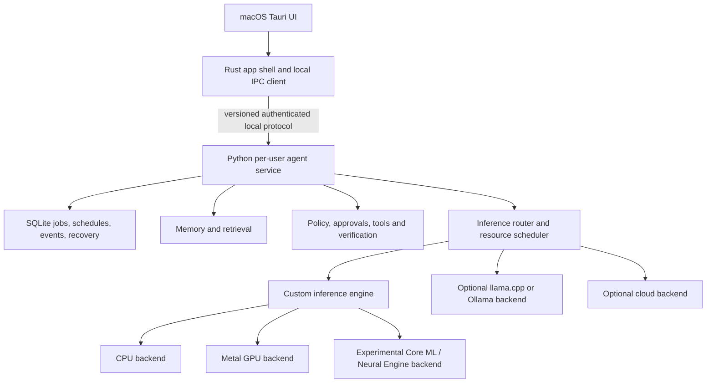

# Milo: target architecture and Aiden salvage assessment

Status: target design proposal. A TypeScript service now implements durable tasks, scheduling, permissioned tools, approvals, recovery, memory and a pluggable inference boundary (mock, local OpenAI-compatible server, reserved custom-engine slot); see [milo-service-design.md](milo-service-design.md) and the decision log in [milo-backend-implementation.md](milo-backend-implementation.md). The custom inference engine is not implemented. The existing repository remains an Aiden-derived TypeScript codebase. [arch.md](arch.md) describes that current system; this document describes the intended replacement. No files should be deleted until the salvage, licensing, and migration decisions are recorded and recoverable.

## Product goal

A macOS-first Tauri application, distributed through a website and optionally an npm installer/launcher, installs a self-contained local agent. A Rust/Tauri shell presents chat, tasks, goals, permissions and background status. A packaged Python service manages persistent tasks, scheduling, memory, tools, recovery and model requests. It continues work while the Mac is awake, subject to login, user settings and system permissions. The intended first run requires no separately installed Python, model server or provider account: install, launch, initialize the bundled model, then use the agent. Show initialization, resource needs, permissions and failures transparently.

The target is the user's “Level 3” autonomy: plan and use tools, recover from failures, and propose or develop skills. This is a product objective rather than a guarantee or established standard. Users set autonomy boundaries; consequential actions require scoped policy and approval, and generated skills do not gain automatic trust.

## Proposed boundaries

- **Rust/Tauri:** native application lifecycle, windows, installer integration, OS permission affordances, and a narrow typed interface to the service. Do not assume the UI process is the background service supervisor.
- **Python service:** durable jobs and attempts, deterministic scheduling, state transitions, evidence and recovery; model-assisted planning and language interpretation; memory, tool execution, policy, and inference request orchestration. CPU/GPU-intensive execution can use native libraries or a separate native engine; Python is the service language, not a requirement that tensor kernels run in Python.
- **Engine boundary:** versioned requests for model identity, messages, structured tool schemas, generation options, cancellation, streamed tokens/tool calls, usage and errors. Use a local IPC transport with authentication, per-user access controls, bounded messages and explicit version negotiation. Do not expose a privileged unauthenticated localhost API.
- **Custom inference engine:** model/weight loader, tokenizer and chat template, tensor operations, transformer forward pass, KV cache and token sampler. Add native CPU and Metal execution behind a backend interface after a correct reference path. Core ML is a separate experimental backend: supported model operations may be placed on the Neural Engine, CPU or GPU by the system. Hardware placement and performance must be measured, not promised. [Apple's Core ML performance guidance](https://developer.apple.com/documentation/coreml/analyzing-a-core-ml-model-s-performance-in-xcode) describes per-operation placement.
- **Runtime intelligence:** deterministic state machines own scheduling, policy, resource limits, execution and validation; the model interprets language and proposes plans/actions. A planner can combine both. Persist decisions and results so the system can resume without mistaking an uncertain external effect for a completed one.

Hybrid inference is the recommended development path: ship an established local backend as a reference and usable fallback while the custom engine matures; cloud is optional and opt-in. Shared model execution, foreground priority, compatible prefix caching, routing, idle unloading and batching are later optimizations, gated by isolation, correctness and measurements. Cached prefixes must not leak private context across users or jobs.

## Model strategy

Model training and inference are separate: building an engine does not create capable weights. Start with a small, openly available model whose license permits the intended bundled distribution, evaluate task/tool reliability, then fine-tune for structured actions and workflows. Continued pretraining of a suitable existing model is the preferred later experiment if evaluation and compute justify it; training from scratch is a longer-term research option requiring substantial data, compute and evaluation. Eight billion parameters is a candidate, not a requirement or a guarantee of acceptable performance on every Mac. Compare smaller models and quantizations on target devices; record model license, weight size, RAM, quality and latency. A small model limits open-ended reasoning even with a strong symbolic runtime.

## What to salvage from Aiden

See [file-dispositions.md](file-dispositions.md) for a provisional per-file inventory. Its rule-based labels require individual review before any deletion or reuse.

Aiden is primarily TypeScript/Node. Python and Rust cannot import most of it directly; the practical route is selective translation, behavior specifications and tests, or retaining a separate Node component temporarily. Reuse does not imply correctness without review.

| Priority | Source | Candidate | Treatment |
| --- | --- | --- | --- |
| High | `core/v4/daemon/jobEngine.ts`, `jobRecoverySweep.ts`, `taskVerification.ts` | Jobs, attempts, events, leases, fencing, uncertain effects and evidence | Port selected invariants and crash/retry tests; choose one authoritative job model. |
| High | `core/v4/automation/scheduler.ts`, `schedule.ts`, `occurrenceKey.ts` | Time zones, missed runs, overlap and deduplication | Port behavior and transaction tests; do not blindly copy coupled database code. |
| High | `core/v4/toolRegistry.ts`, `tools/v4/index.ts`, `moat/approvalEngine.ts`, `dangerousPatterns.ts`, `ssrfProtection.ts` | Tool schemas, risk metadata, approvals and network policy | Design a Python tool contract and independently enforce permissions at execution; start with a small reviewed tool set. |
| High | `core/v4/memoryManager.ts`, `memory/namespaceRegistry.ts`, `memory/provenance.ts`, `core/v4/sessionStore.ts` | Scoped memory, provenance and session persistence | Adapt data model and tests; distinguish durable memory from inference RAM and KV cache. |
| High | `providers/v4/types.ts`, `core/v4/workbench/bridgeServer.ts` | Model request and streaming contracts; task and approval events | Use as protocol references, redesign for Python/Rust and authenticate the local boundary. |
| Medium | `core/v4/skillLoader.ts`, `skillSpec.ts`, `skillSecurityScanner.ts`, `moat/skillTeacher.ts`, `skills/` | On-demand skills and proposed skill creation | Review formats and quality checks; treat scanners as heuristic and new skills as untrusted. |
| Medium | `dashboard-next/components/`, `dashboard-next/lib/aidenClient.ts` | Onboarding, task, memory and workflow UX | Reuse concepts or selected components only after checking dependencies and license; replace Aiden-specific API bindings. |
| Medium | `tests/v4/moat/`, `tests/v4/tools/`, `tests/v4/toolRegistry.security.test.ts`, `evals/` | Failure, permission and agent behavior cases | Translate relevant cases to Python/Rust tests and add real crash and duplicate-effect scenarios. |
| Low | `electron/`, `api/server.ts`, legacy `core/agentLoop.ts` | Old shell and runtime paths | Reference behavior only; they are not the intended Tauri/Python implementation. |

Aiden does not provide the requested custom tensor/transformer engine or trained model. Its provider adapters invoke external inference and are useful mainly as contract and behavior references.

## Desktop app and CLI distribution

The desktop app and CLI are two clients of the same per-user Python service and its authenticated, versioned local protocol. They share task state, memory, approvals and inference rather than launching independent agents or competing schedulers. The Rust/Tauri app supplies the visual experience; a standalone CLI can submit tasks, check status, manage the service and expose scripting-friendly output. Service discovery, version compatibility, startup, multiple-client concurrency and updates must be designed and tested.

The website can distribute a signed and notarized macOS app containing the service, runtime and compatible model. A separately published npm package can expose a `milo` executable using npm's `bin` mapping; it can install or launch an appropriately packaged native CLI and connect to the same service. npm requires Node and npm for that installation path, while website app users should not need them. Whether a CLI-only installation also bundles the service/model or requires a separately installed app remains an open packaging choice. Neither channel has been implemented or published for Milo.

For reference, Aiden previously published `aiden-runtime`, with npm command entries pointing at `bin/aiden-bootstrap.cjs`. This checkout is now private and no longer registers those commands or the transitional `milo` alias; the legacy bootstrap remains only as a reference. This does not affect any package already published by its owner. The future Milo CLI and npm package have not been built.

The user wants all salvageable Aiden material retained. Keep the existing source and the inventory available until each reuse or replacement decision is made; removing other material is a separate deliberate migration, after preserving a recoverable reference and resolving applicable licensing.

## Website-first distribution and migration

The primary distribution experience is a Milo website offering a direct macOS app download. The intended downloadable app includes the Tauri shell, packaged Python service and a compatible licensed model, so users do not need to install Node, Python, Ollama or a separate model to begin. Deliver a signed and notarized app/DMG, show supported hardware and download size, and provide transparent installation, first-run initialization, background-service controls, updates and uninstall instructions. A download website does not itself create or deploy an agent on the user's Mac; the installed application provisions and starts the local service with the user's choices and required macOS permissions. Actual release infrastructure, signing and model packaging are future work.

Keep a CLI as a separate user-facing client of that same service. An optional npm package can install or expose the CLI for terminal users; the website app installation must not require npm. Decide how the CLI is exposed to shell PATH and whether a CLI-only installation includes the service and model. Both clients must discover the same per-user service, respect the same permissions and share task and memory state.

The planned Rust/Tauri app and the new CLI will be built for Milo's architecture. The existing Electron app and TypeScript CLI are Aiden implementations, so they should not be assumed to become the new clients unchanged. Preserve them and all identified salvageable components as references or reuse candidates while designing and building their replacements; do not wipe the repository or delete existing components as part of this plan. Reuse appropriate behavior, UI, tests and code after license review. Any later removal should follow a documented inventory, a recoverable reference and an explicit migration decision.

## Background lifecycle and delivery

For an always-available per-user service, evaluate a bundled helper registered through macOS Service Management / a LaunchAgent, with explicit enable, pause, quit, login and uninstall behavior. A service cannot execute during system sleep; after wake or login it must reconcile missed schedules and interrupted work. Ask for macOS privacy permissions only when needed. Apple describes per-user agents and background service management in its [Service Management documentation](https://developer.apple.com/documentation/servicemanagement/) and [background-process guidance](https://developer.apple.com/documentation/appkit/managing-ongoing-background-processes-in-your-mac).

Package the Python interpreter and dependencies as a signed helper, not a system Python requirement. Tauri supports [embedding platform-specific sidecar binaries](https://v2.tauri.app/develop/sidecar/), but a persistent login service needs a lifecycle design beyond a child process launched by a window. Bundle a licensed compatible model for the zero-external-setup goal; validate its size, integrity, updates and disk requirements. Website distribution should deliver a signed, notarized macOS app/DMG; npm is an optional installer/launcher that obtains or installs the same verified artifact, not itself an app bundle. See [Apple's notarization guidance](https://developer.apple.com/documentation/security/notarizing-macos-software-before-distribution).

## Safety and reliability acceptance criteria

- Persist task state and effect intent before execution; recover idempotently and surface unknown external outcomes rather than blindly retrying.
- Model output is untrusted. Validate schemas, scope filesystem/network/process permissions, and require approval for configured consequential actions. Keep secrets out of prompts and logs where possible.
- Show running tasks, approvals, resource use and service status; allow pause, cancellation, disable-at-login and uninstall. Define what happens on app close, sleep, logout, crash and upgrade.
- Test adversarial tool inputs, tool failures, duplicate triggers, crash recovery, cancellation, corrupted state, unavailable models, permissions and low memory. Measure task success as well as latency, RAM, power and throughput.

## Suggested first milestones

1. Record source inventory and licensing decisions; preserve an accessible Aiden reference before any destructive cleanup. Decide the repository and history strategy.
2. Build a thin Tauri shell and packaged Python service with authenticated IPC, lifecycle controls and a deterministic mock inference backend. Verify launch, restart, sleep recovery, stop and uninstall on an Apple Silicon Mac.
3. Add durable task storage, scheduler, a few permissioned tools, approval UI and recovery tests. Demonstrate one end-to-end task with observable evidence.
4. Integrate a licensed local model via an established backend; benchmark task quality and resources. Prototype fine-tuning separately.
5. Implement a reference custom inference engine and compare tokenizer, logits and generated outputs against a trusted implementation. Add cache and native acceleration only after correctness tests.
6. Investigate Core ML / Neural Engine and Metal with device-specific profiles; add resource scheduling, packaging, signing and update flows based on measured results.

## License and decisions

The root [LICENSE](LICENSE) and package metadata identify core code as AGPL-3.0-only. [LICENSE-SKILLS.md](LICENSE-SKILLS.md) separately states that `skills/` and certain skill scaffolding are Apache-2.0. Copying or translating implementation can carry license obligations; assess exact files, third-party dependencies, assets, model weights and intended distribution with qualified counsel before reuse. Independent design informed by behavior is a separate question, not an automatic license exemption.

Open choices: minimum macOS version and RAM, Apple Silicon-only versus Intel, precise autonomy and approval policy, app-close behavior, IPC technology, engine implementation language, model/weight license, first model size, website/npm packaging strategy, and whether Milo will retain AGPL or seek other rights. No source deletion or engine implementation has been performed by this assessment.
