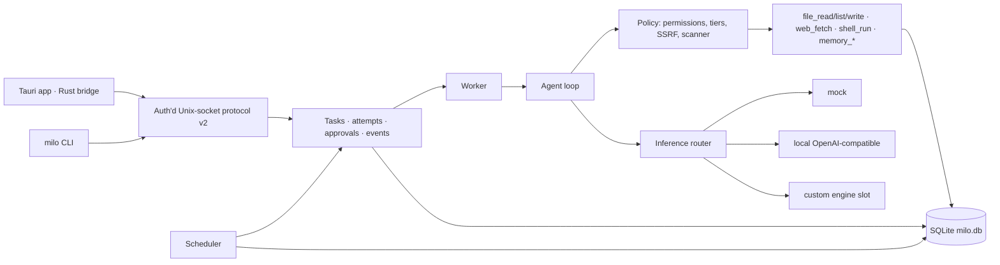

# Milo background service

## Purpose and status

`milo-service/` is Milo's per-user background agent service, written in TypeScript on Node 22.13+ with no npm dependencies. It owns durable tasks, the agent loop, scheduling, permissioned tools, approvals, crash recovery, memory and the inference boundary. The Tauri app and the `milo` CLI are both clients of it. The custom inference engine is not implemented; it attaches to the inference router described below. Decisions and their reasons are recorded in [milo-backend-implementation.md](milo-backend-implementation.md).

The default inference backend is a deterministic **mock** that runs no model and labels its output as a placeholder. A local OpenAI-compatible server (Ollama, llama.cpp `llama-server`) can be selected; it has been exercised with `qwen2.5-coder:7b`. Being able to run a task end to end is not evidence of broad agent capability; measure task quality separately (see [model_selection.md](model_selection.md)).

## Architecture



| Module | Role | Aiden source repurposed |
| --- | --- | --- |
| `service.ts` | Entry point: private directory, single-instance lock, legacy import, recovery, auth token, socket server, scheduler timer | prototype |
| `cli.ts`, `src/client.ts`, `src/launchd.ts` | CLI client; per-user LaunchAgent install/uninstall/status | `cli/v4/commands/`, `core/v4/daemon/supervisor.ts` |
| `src/store.ts` | SQLite schema, transactions, events (persisted, pushed after commit), settings | `core/v4/daemon/db/` (concepts) |
| `src/jobs.ts` | Task state machine, message log, attempts, tool-call records, approvals, cancellation, crash recovery | `daemon/jobLifecycle.ts`, `jobEngine.ts`, `jobRecoverySweep.ts` |
| `src/agent.ts`, `src/worker.ts` | Step loop: model → policy → approval → effect record → execute → result; single worker | `core/v4/aidenAgent.ts`, `daemon/runs/retryPolicy.ts` |
| `src/effects.ts` | Effects recorded before mutation; filesystem reconciliation after a crash | `effectContract.ts`, `effectReconciliation.ts` |
| `src/policy/` | Dangerous-command patterns and read-only proof, SSRF guard, secret/injection scanner, final approval enforcement | `moat/dangerousPatterns.ts`, `ssrfProtection.ts`, `tirithScanner.ts`, `approvalEngine.ts` |
| `src/tools/` | Registry with schema validation; the seven built-in tools; path scoping | `core/v4/toolRegistry.ts`, `tools/v4/files/`, `tools/v4/web/webFetch.ts` |
| `src/memory.ts` | Namespaces, `said`/`saw`/`guess` provenance, keyword search, bounded prompt block | `core/v4/memory/`, `memoryManager.ts` |
| `src/cron.ts`, `src/scheduler.ts` | Time-zone cron, interval and one-shot schedules; misfire, overlap and occurrence-key dedupe | `core/v4/automation/` (replaces `croner`) |
| `src/inference/` | Normalized types, mock, OpenAI-compatible adapter with text tool-call recovery, router | `providers/v4/types.ts`, `chatCompletionsAdapter.ts`, `localPromptToolsAdapter.ts` |

Ported files carry a header naming their Aiden source and its AGPL-3.0-only license; the licensing decision in [milo-plan.md](milo-plan.md) is still open.

## Running

```sh
cd milo-service
npm start                 # foreground; or bin/milo service start
bin/milo help
npm test                  # unit + end-to-end tests against spawned services
npm run typecheck
```

State lives in `~/Library/Application Support/Milo/service` (`MILO_SERVICE_DIR` overrides it): `milo.db` (0600), `service.sock` (0600), `service.lock`, and `auth.token` (0600, regenerated every start, removed on clean stop). The directory must be owned by the user with no group/other access. A v1 `tasks.json` is imported once and renamed to `tasks.json.imported`; a corrupt one aborts startup without being modified. Task goals, tool arguments and results are stored in plaintext in the database.

## Protocol v2

Newline-delimited JSON over the Unix socket, at most 64 KiB per request line. Requests: `{"id", "auth", "method", "params"}`; responses `{"id", "result"}` or `{"id", "error", "code"}`. `auth` must equal the current `auth.token`. Same-user processes can read that file, so this restricts access to the user account, not to a particular application.

| Area | Methods |
| --- | --- |
| Session | `hello` (version negotiation), `health` |
| Tasks | `tasks.create {goal}`, `tasks.list {status?}`, `tasks.get {id, detail?}` (detail adds tool calls, effects, attempts, approvals, messages), `tasks.cancel`, `tasks.review {id, action: resume\|cancel}` |
| Approvals | `approvals.list {status?}`, `approvals.decide {id, decision: approve\|deny}` |
| Schedules | `schedules.create {goal, expression, timezone?, misfire?, overlap?}`, `schedules.list`, `schedules.setEnabled`, `schedules.delete`, `schedules.preview` |
| Memory | `memory.namespaces`, `memory.list`, `memory.add` (stored as `said`), `memory.delete`, `memory.search` |
| Settings | `permissions.get/set`, `settings.get/set {inference?, agent?}`, `tools.list` |
| Events | `events.list {after, taskId?}`; `events.subscribe {after?}` turns the connection into a stream of `{"event": …}` lines |

Schedule expressions: five-field cron (`0 9 * * mon-fri`, macros like `@daily`), `interval:<ms>` (≥ 60 s) or `oneshot:<ISO time>`.

## Task lifecycle and recovery

`queued → running → completed | failed | cancelled`, with `waiting_approval` (parked until a decision; the worker moves on) and `needs_review` (an action's outcome could not be verified after a crash). Every model step, tool call, decision and result is persisted before the next step, so the loop can resume from the database.

Before a mutating tool runs, its effect is recorded as `intended` with what success would look like (for file writes, the SHA-256 of the intended content and the file's prior state). After a crash, startup reconciles each intended effect: confirmed → recorded as applied; provably not applied → reported to the model as not executed; anything else → `needs_review`, never retried automatically. Tasks with no unresolved effects resume, up to `maxRecoveries` (3) times. Shell commands cannot be reconciled and go to review if interrupted. A user cancel aborts the running model call or command; a service shutdown leaves the task for recovery.

## Policy and tools

Nothing is granted by default: no folders, no network, no shell. Policy is evaluated by the service; model output is untrusted.

- File tools resolve real paths (symlinks included) inside granted folders and refuse sensitive locations (`.ssh`, keychains, Milo's own directory, `.env` files).
- `file_write` asks unless "write files without asking" is on; content flagged by the scanner (secrets, bidi overrides, homograph URLs) always asks. Approval prompts preview the content.
- `shell_run` always asks for approval and records a process effect. Its working directory must be in a granted folder, but the command runs with the user's OS authority and is not confined to that folder or denied network access.
- `web_fetch` checks every redirect hop against the SSRF guard (private, loopback, link-local, CGNAT, metadata, mapped IPv6).
- `file_write`/`shell_run` planned in the same model step as earlier, unseen calls are deferred until the model has seen those results.
- Approvals are per call and bound to an argument digest. Results returned to the model are capped at 16 KiB.

## Inference boundary

`InferenceBackend` (`src/inference/types.ts`): `identity`, `ready()`, `call(request)` and optional `stream(request)`. Requests carry normalized messages, tool schemas, limits, an abort signal and the task id; results carry content, structured tool calls, finish reason and usage. Error classes (`NetworkError`, `TimeoutError`, `ResourceExhausted`, `AuthError`, `ValidationError`, `Unavailable`, `Cancelled`) drive retry: the first three are retried with jittered backoff up to three times per step.

The custom engine plugs in with `registerEngine(factory)` in `src/inference/router.ts` and is selected with `settings.set {inference: {backend: "engine"}}`. Until registered, selecting it reports Unavailable rather than silently falling back. Non-loopback inference URLs require `allowRemote`; API keys come only from `MILO_INFERENCE_API_KEY`.

## Clients

The Tauri app's Rust bridge (`milo-app/src-tauri/src/lib.rs`) reads the token per call and exposes one command per method; the webview cannot call arbitrary methods. The Permissions screen shows real permissions and the approval queue. The CLI (`bin/milo`) covers the full protocol. `milo service install` registers a development LaunchAgent; packaged releases should use a signed helper registered through Service Management.

## Limits

Not yet provided: multi-user isolation, application attestation for the socket, shell sandboxing, session-wide approval grants, embeddings for memory search, Developer ID signing, notarization, and updates. The service cannot run while the Mac sleeps; schedules catch up according to their misfire policy when it wakes.

## Desktop integration update

The desktop app connects to an existing service or starts its bundled sidecar. It can stop the process it started; other supervisors retain control of their own service. The packaged service and a small notification helper live inside the app bundle. Notification opt-in is stored by the service, while macOS authorization is requested only when the user enables it. Committed task-completion and approval-request events send generic notifications through the helper, including while the app is closed. Delivery errors are recorded and visible in Permissions. The development service reports this helper unavailable.

The app provides goal, schedule, memory, skill-proposal and task-detail views. It receives transient draft text through the authenticated event connection. Skill candidates contain only names of successful tools from a completed trace, and remain unavailable until accepted; they are untrusted reference material and can be removed. See [milo-backend-remaining.md](milo-backend-remaining.md) for verification and open items, and [PACKAGING.md](milo-service/PACKAGING.md) for local build requirements.
